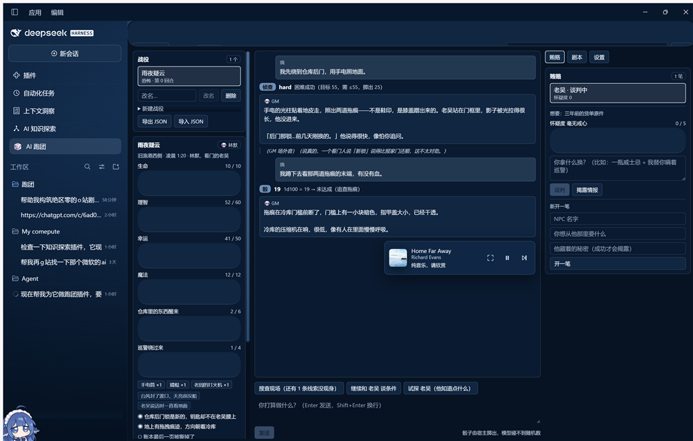

# DSH TRPG — 给 DeepSeek Harness 的 AI 跑团插件

> 非官方第三方插件，与 DeepSeek 官方无关。装上它会**接管你的会话视图、调用你的模型账号、并在工作区之外写文件**。装之前先读 [⚠️ 副作用与意外产物](#-副作用与意外产物)。

给 DSH（DeepSeek Harness）客户端加一个**说人话的 GM**：能读你的剧本、会吐槽、替你掷骰子、还能被玩家拿好处套出情报。

侧栏出现 **🎲 AI 跑团**，点开就是完整跑团面板。



*真实运行截图（不是效果图）：战役「雨夜疑云」、属性条、进度钟、骰子 chip、GM 气泡与场外音、贿赂面板。*

---

## 它做什么

| 功能 | 说明 |
| --- | --- |
| **适应剧本** | 粘贴任意长度的剧本原文（Markdown 标题 / `第一章` / `【场景】` 都认）。GM 只拿到一份**摘要**，不会照着剧本念，玩家走到哪它讲到哪；确认要找线索时会要求过检定。 |
| **GM 吐槽** | 自带 60+ 条中文单行吐槽库，按心情（8 种）与情境分类。GM 每回合开头给个情绪，吐槽会避开最近说过的，不会复读。强度 0~5 可调。 |
| **骰子** | `1d100`、`2d6+1`、`4d6kh3` 这类公式都能掷；带 COC 风格的检定（常规 / 困难 / 极难，奖励骰与惩罚骰），大成功与大失败有专门判定。 |
| **贿赂与情报** | 每个 NPC 可以有一件**秘密**。玩家给的东西够不够分量，由规则算分：金额与具体性加分，NPC 对你的态度加分，怀疑度与反复磨嘴皮子扣分。成交才会松口。 |
| **拟人** | GM 有自己的口吻与立场，会阴阳玩家、会不耐烦、会在大失败时嘲笑；但每句吐槽都必须把剧情往前推。 |

### 一条硬规矩

**模型永远拿不到随机数。** 骰点只能在服务端由 `lib/dice.js` 掷。模型想掷骰只能写 `<<roll 1d100 dc=55>>` 这样的指令，宿主解析后自己掷，再把结果写回叙述里。这样模型无法伪造成败，也骗不了玩家。

---

## ⚠️ 副作用与意外产物

请当成**第三方代码跑在你的用户权限下**来对待。以下是实际会发生的，不是理论风险：

### 会动你的东西

| 副作用 | 细节 | 怎么收拾 |
| --- | --- | --- |
| **改你的 profile 清单** | `scripts/install.mjs` 会**文本级改写** `~/.dsh/profiles/desktop/package.json`：加一条 `link:` 依赖 + 一个 `dsh.profile.bundles` 条目。不做 JSON 重排版，但你的注释/顺序会被动。 | 它写前备份成 `package.json.pre-dsh-trpg.bak`（已存在则不覆盖）；或 `node scripts/install.mjs --uninstall` |
| **在工作区外写文件** | 运行期在 `~/.dsh/dsh-trpg/` 写 `state.json`（全部战役、线报、账本）与 `scenarios/<campaignId>.json`（你导入的剧本原文）。**这些不在你的仓库里**，卸载插件也不会删。 | 面板里「导出 JSON」；或手动删目录 |
| **建 junction** | 在 `~/.dsh/profiles/desktop/node_modules/dsh-trpg` 建指向本仓库的 junction。**仓库一旦被移动/删除，DSH 启动时这条 bundle 就加载失败。** | `--uninstall` 会摘掉它 |
| **残留坏档** | `state.json` 读坏时不会崩，而是**改名留证**成 `state.json.corrupt-<时间戳>` 再开空档。长期反复出问题会攒下一堆 `.corrupt-*`。 | 手动删 |
| **会话视图被接管** | 面板注册在 `main` slot（`replaceRisk: "shadows-shipped-ui"`），**打开时会替换掉整个会话视图**。 | 面板左上角「← 返回会话」，或换侧栏项 |

### 会花你的钱 / 送出你的数据

- **调用你的模型账号**：发一句话就走 DSH 的 `llm.stream`，用的是你在 DSH 里配的 provider 与 key。**费用按你的账号结算。**
- **送出去的内容**：发给模型的上下文包含 —— 战役设定、当前场景、NPC 与线索、**最近 80 条线报**、**你导入的剧本摘要**。也就是说**你粘进「剧本」框里的原文会有一部分进入模型请求**。别粘机密材料，也别粘你没有权利外传的受版权保护的剧本。
- **提示词注入面**：剧本原文是不可信输入。恶意剧本可以试着让模型越权（改写规则、假装骰点）。插件已经把随机数锁死在服务端，但**模型仍然会照着剧本里的坏指令说话** —— 它骗不了骰子，不代表它不会骗你。

### 已知不完善

- **改代码后必须手动重启 DSH**：插件源码模块不热重载（只有 profile 的 `cordis.patch.yml` 变化会触发重组）。你在源码里的修改不会即时生效。
- **界面上的文本输入无法被自动化驱动**：Chromium 里的 React 受控 input 收不到合成键鼠事件。写自动化测试时别指望用模拟输入填表，直接打 HTTP 路由。
- **没有权限模型**：任何能开这个面板的人都能删战役、清线报。它是单人桌面工具，不是多人服务器。
- **剧本解析是启发式的**：认 Markdown 标题、`第N章`、`【场景】`。格式奇怪的长文可能只切出一节。切得不好就先手动加标题。
- **界面只画宿主算好的状态**：所有规则在服务端，界面不重算 —— 这是为了不出两套真相，代价是改一处 UI 往往要连带动 `lib/view.js`。
- **`snark` 与吐槽库是中文的**：换语言得自己写库（`lib/gm.js`）。

### 它**不会**做的事

- 不会连任何第三方服务器（除了 DSH 自己配置的模型 provider）。
- 不会读你的会话历史、别的插件数据、或工作区里的其它文件。它只读写 `~/.dsh/dsh-trpg/`。
- 不会自己升级、不会自己上传任何东西。

---

## 安装

```bash
# 装进 desktop profile（会加一条 link: 依赖 + 一个 bundle 条目，并备份原清单）
node scripts/install.mjs

# 只看看会改什么，不落盘
node scripts/install.mjs --dry-run

# 卸载
node scripts/install.mjs --uninstall
```

装好后刷新 DSH 的 Web 界面，侧栏会多一个 🎲 **AI 跑团**。

档放在 `~/.dsh/dsh-trpg/`（`state.json` 与 `scenarios/`）；`DSH_HOME` 可覆盖。

> 本插件零第三方依赖，不需要 `pnpm install`。装法只有上面这一种 —— 它是本地 `link:` 安装，不走 npm registry。

---

## 怎么玩

1. 侧栏点 **🎲 AI 跑团**。
2. **战役** 卡片：填名字、角色名、基调、前言 → 新建。
3. **剧本** 卡片：把剧本原文粘进去 → 导入。目录、检索、读节都在这里。
4. 中间输入框说你要做什么（"我撬开地下室的门"）。GM 会流式回你，需要判定时自己掷骰并告诉你结果。
5. **骰子** 卡片：想手动掷就掷，公式随便填。
6. **贿赂** 卡片：选 NPC → 说要拿什么换 → GM 会演出谈判，并在结尾给出判定（成交 / 讨价还价 / 拒绝 / 不再谈）与怀疑度。
7. 谈成了，NPC 的秘密会以 `【情报】` 的形式进线报并落进账本。

**返回会话**：面板左上角的 ← 按钮，或按侧栏图标切换。

---

## 给模型的两条指令

GM 在回复里可以用这两行方括号指令，宿主会解析并执行，**界面上不会显示它们**：

```
<<mood ominous>>                     心情：决定 GM 的说话口吻与表情
<<roll 1d100 dc=55 reason=撬锁>>      请求掷骰；dc 给了就判达成
<<bribe granted price=一瓶酒>>        贿赂判定（另见 /bribe 流程）
```

没闭合的 `<<` 会被忽略（模型话说一半很正常），非法公式只报一条错误，**不会毁掉整个回合**。

---

## 目录结构

```
dsh-trpg/
├─ package.json            # 零依赖；main/exports/dsh 三个块
├─ cordis.patch.yml        # bundle patch：一行 insert
├─ CONTRACT.md             # 冻结契约（当初派活用的规格书）
├─ docs/screenshot.png     # 真实运行截图
├─ lib/
│  ├─ index.js             # 宿主半：七条路由 + SSE
│  ├─ schema.js            # 存档唯一权威 + 全部上限与钳制
│  ├─ commands.js          # 唯一写入权威：~30 条命令
│  ├─ store.js             # 落盘（原子写 + 坏档隔离）
│  ├─ dice.js              # 骰子与检定
│  ├─ scenario.js          # 剧本解析 / 摘要 / 检索
│  ├─ gm.js                # GM 人格：吐槽库 + 指令解析
│  ├─ bribe.js             # 贿赂判定策略
│  ├─ prompt.js            # 提示词装配
│  └─ view.js              # 派生视图（界面不重算）
├─ client/client.js        # 浏览器半：plain IIFE，React.createElement
├─ scripts/
│  ├─ check.mjs            # 静态契约检查
│  ├─ build.mjs            # 无打包器"构建"：语法校验 + 拷进 dist/
│  ├─ verify.mjs           # 五步验收，全过打印 all steps passed
│  └─ install.mjs          # 装进 profile / 卸载
└─ test/                   # 9 个测试文件，230 条用例
```

---

## 开发

```bash
node scripts/verify.mjs        # 五步验收（静态检查 → 构建 → 测试 → 产物 → 干跑安装）
node scripts/check.mjs         # 只跑静态契约检查
node --test --experimental-test-isolation=none test/*.test.js
```

`verify` 的五步：静态契约 → 逐文件语法检查 + 拷出 `dist/` → 单元测试 → 校验 `dist/` 产物 → 安装干跑。全过打印 `all steps passed`。当前 **230 / 230 通过**。

> **必须带 `--experimental-test-isolation=none`**：本机沙箱里 Node 的测试运行器默认会给每个文件 spawn 子进程，直接 `spawn EPERM`。不带这个旗标时**测试根本没被加载**，看起来像"全绿"其实是空跑。

### 架构上的几条硬约束

这些都是踩过的坑，改代码前先看一眼：

1. **已安装 bundle 的 factory 只收到 `require` 一个参数**，`host.call` 这类私有 JSON RPC 只对动态定义的包开放。所以浏览器半一律走自己的 HTTP 路由 + 普通 `fetch`。
2. **每条路由必须显式写 `requestBody: "buffered"`**。漏写时共享 Fetch 层会把请求当 streaming，无 body 的 GET 会被构造成带 body 的 `Request` 并抛错 —— handler 根本不跑，浏览器收到空响应。`check.mjs` 会对每条路由校验这一点。
3. **每条 assistant 线报必须带 `source: { kind:"model", provider, model }`**，否则 `dsh-llm` 派发时读 `message.source.replayState` 会抛错。
4. **服务端是唯一写入权威**：界面不能自己拼半个节点，一切变更走 `applyCommand(state, command, ctx)`。
5. **主题 token**：填充用 `--dsw-alias-button-primary-fill` + 文字 `--dsw-alias-label-primary-foreground`。绝不要把 `--dsw-alias-brand-primary` 当背景 —— 它是 ink token（浅色近黑、深色近白），配白字在深色主题下对比度 1.05:1，完全看不见。

---

## 许可

MIT。见 [LICENSE](LICENSE)。

第三方插件，非 DeepSeek 官方作品，不含任何担保。装上它意味着你接受上面「副作用与意外产物」里写的全部行为。
